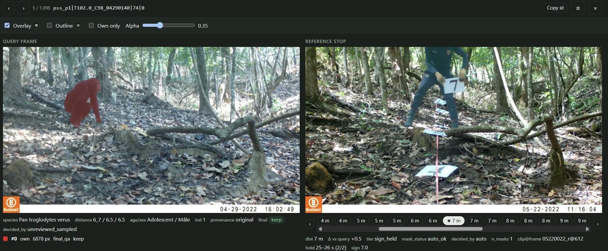

# Reference-Based Distance Annotation

**Status:** Implemented workflow at `/distance-review`. This is the authoritative
workflow/design document; it replaces the earlier
[depth-estimation proposal](./distance-annotation.md). Research export and transfer
remain deferred. See the [cleanup plan](./distance-branch-cleanup-plan.md) for
migration consolidation, development-database recovery, and validation status.

## Approach

Annotators estimate an animal's distance by selecting a prepared reference frame
showing a patrol team member at a known distance. The chosen frame supplies the
sample's exact distance in meters, including fractional distances. There is no
free-form distance-entry field during animal annotation.

Distance identities, samples, queue, and completion are independent of ordinary
Review. Ordinary species/count annotations provide context and omission warnings;
they do not create or synchronize Distance observations automatically.

## Annotation Workflow

1. Import reference clips in a deployment's paired `references/` and `videos/`
   layout to tag them **Reference Video** automatically, or tag other reference
   clips manually in ordinary Review. Open **Distance** and prepare their
   known-distance frames for the deployment.
2. Align the animal video's camera clock using the visible timestamp, not file
   metadata. Confirm the displayed even-second transition frame and its camera
   timestamp in the independent clock dialog.
3. Add an individual on its identifying first-seen frame. Choose species and draw
   a bounding box. Earlier scheduled samples are saved as **Absent**; samples at
   or after first sighting remain unreviewed. Creation retains the identifying
   frame while selecting the first scheduled sample at/after it, or the final
   sample when first sighting is later than the last stop.
4. At each scheduled sample, select a prepared reference, **Not visible**, or
   **Absent**; set sample behaviors and any carried infant, then confirm.
5. Saving plays the consecutive interval and pauses at the next scheduled sample,
   even if that sample was already reviewed. Confirming/skipping the final sample
   retains it and shows **End of video**; it never switches individuals, returns
   to earlier gaps, or finishes/advances the video automatically.
6. Review other individuals manually. Full sample coverage completes each
   individual automatically. Use **Finish video** explicitly after all animals
   have been added and all individuals are complete.

Selecting a reference only changes the current form, not saved evidence. Existing
samples remain editable; a missing sample row means unreviewed, not absent.

### Camera clock and sampling

- Sample every even second of the camera's timestamp, not every two playback
  seconds. A clip starting at `16:02:49` samples at camera `16:02:50`, `:52`, `:54`.
- Select the first frame showing an odd-to-even transition and enter that even
  whole-second camera time. Confirmation pauses/captures the displayed frame;
  there is no additional frame-selection/verification action.
- Mark whether the opening still already shows an even second. If so, that still
  is also required, and alignment normally uses the next odd-to-even transition.
  A short clip ending before a transition may use its even opening still.
- Alignment is shared across individuals/annotators. After verification, timestamp-only
  corrections must be whole multiples of two seconds and preserve the exact anchor,
  opening-even setting, and scheduled playback offsets. They retain all annotations,
  progress, and completion, and update verification attribution/time.
- Changing the alignment frame or opening-even setting requires explicitly choosing
  **Change alignment frame and reset Distance review** and confirming the destructive
  warning. The reset atomically deletes every Distance individual (including infants),
  box, attribute/tag, sample/behavior, resume state, and completion for this video,
  including other annotators' work, before saving the new alignment. Other videos,
  prepared references, and ordinary Review remain unchanged. Cancellation or invalid
  alignment leaves the existing review intact.
- `videos.created_at` is only a suggested time. Store the verified camera wall clock
  without timezone conversion, separately from file metadata. Display camera times
  in 24-hour format; the clock dialog accepts `YYYY-MM-DD HH:mm:ss` explicitly,
  independent of browser AM/PM preferences.
- Preserve precise playback anchors independently of integer-millisecond sample
  identities. For example, a `16:02:50` anchor at playback `0.920 s` schedules the
  next camera sample at `2.920 s`, not `3.000 s`.
- Estimate the first frame at/after a sample boundary from reported FPS and anchor
  phase. Probe metadata once per file with a two-second timeout; do not scan all
  frames while loading. Without FPS, use a 40 ms margin shortened near clip end.
  The opening sample remains the opening still.
- Direct sample seeks pad ten microseconds inside the estimated frame to avoid
  its predecessor. Saving verifies the displayed position using frame-based
  tolerance. Irregular/dropped frames may still show a neighboring frame; stored
  sample identities and camera timestamps do not change.

### Navigation and inspection

- **Play to this sample** replays from the preceding scheduled sample. For the
  first scheduled sample, replay from the video opening when its offset is
  nonzero; omit the action when the first sample is already the opening frame.
  Playback pauses at the selected sample without saving evidence or navigating.
- Manual annotation pauses snap to the most recent scheduled sample at/before
  the pause position. Automatic stops seek the intended next scheduled frame to
  correct callback delay. Programmatic pause events must not retrigger snapping.
- Explicit inspection seeks/frame steps remain unsnapped. Clock and fixed-frame
  box dialogs are exempt. Choosing a reference restores the animal to the
  selected annotation sample without an explicit **Return to sample** button.
- Card selection and **J/K** always pause at that individual's first-seen frame,
  regardless of saved coverage or the previous playback position. The first-seen
  button selects its own individual and works even when already active.
- Opening a saved session instead restores the annotator's active individual and
  next unreviewed sample. Creating an individual keeps its chosen identifying
  frame. These paths deliberately have different navigation rules.
- There are no per-frame or per-individual draft caches. Leaving a sample or
  switching individuals discards unconfirmed distance, visibility, behavior, and
  infant edits. Revisited samples restore saved evidence; new stops prefill the
  preceding confirmed choice and metadata for that individual. Without preceding
  evidence, select the smallest available distance and empty metadata. Neither
  navigation nor prefilling writes or overwrites evidence. Individual attributes
  save immediately and are rendered directly from their saved values.
- Reference browsing retains sample behaviors, infant choices, visibility choice,
  brightness/contrast, and the animal player. Reuse the reference player on clip
  switches; keep its prior image until the next source has loaded and sought.
  Pages own independent media URLs, released when their client is deleted.
- **Absent** and **Not visible** dim the reference image, including restored
  saved choices. Browsing clips preserves dimming; selecting a distance
  restores the image without recreating the player or changing image settings.

### Apply to end

**Apply to end** repeats the selected distance/reference or visibility choice,
behaviors, and carried-infant assignment from the current sample through the final
scheduled sample, inclusively, in one transaction. Confirmation names the choice,
individual, starting offset, and affected count, and warns that **all existing
annotations and skips are overwritten**. There is no preserve-only mode.

A new infant is created once and reused across the interval. Other individuals
and earlier samples are unchanged, except for linked infant evidence being
corrected. Tags remain individual-wide. Success selects/pauses at the final sample
for the current individual without finishing the video. Cancellation or failure
retains the previous selection/playback. Ordinary sample corrections remain
available; there is no separate bulk-absence or bulk-undo API.

### Individuals and carried infants

- Each individual has a durable UUID and an incremental displayed number within
  the video. Species, age, sex, and tags belong to the individual; behavior belongs
  to each sample. Age/sex may remain unset. Allowed ages are `Adult`, `Adolescent`,
  `Juvenile`, `Infant`; sexes are `Male`, `Female`, `Unknown`.
- Species defaults, in order, to the active species filter, active individual,
  then the clip's first reviewed species. The selector remains editable across
  project vocabulary, with saved species still available outside that vocabulary.
- Metadata saves immediately. Species corrections retain identity/evidence and
  update linked carriers/infants together to preserve their same-species rule.
  Edits reopen explicit video completion; ordinary Review is unaffected.
- Creating an individual requires a complete normalized box on its first-seen
  frame. Geometry is relative to original video dimensions, corrected for zoom,
  pan, and letterboxing, with positive dimensions entirely inside 0–1.
- Add/redraw dialogs start in box mode on an independent fixed-frame player and
  inherit brightness/contrast. Zoom, pan, fullscreen, cancellation, and save
  guards remain available. Redraw changes geometry, not the identifying frame.
- Show all boxes matching the displayed first-seen frame: selected yellow,
  inactive gray, with readable numbers even for coincident parent/infant boxes.
  Outline spacing is display-only; never change saved geometry or show boxes on
  adjacent unrelated frames. Tracking across later frames remains manual.
- A newly carried infant inherits its parent's identifying frame **and box**,
  defaults to `Infant`/`Unknown`, and keeps its own UUID after becoming independent.
  The creation dialog's **Carries an infant** checkbox creates both identities
  atomically, without distance evidence, and preselects that infant for the
  carrier's first sample.
  The infant stores its initial carrier so that this default survives reloads and
  form restoration. It applies from creation until saved carrier evidence takes
  precedence; it is not a permanent carrying assignment for every sample.
  Age, sex, and eligible individual tags are optional creation fields and apply
  only to the carrier, not the automatically created infant.
  Scheduled samples strictly before infant **creation** are absent; this cutoff
  is not the inherited first-seen offset. Do not clone the parent's whole timeline
  or prefill later absence.
- While carrying is active, parent assignments atomically copy evidence,
  visibility choices, and behaviors to that same infant, for manual and suffix
  writes. Both individuals must belong to the same video/species; self-carrying,
  nested carrying, and simultaneous different carriers are rejected.
- Viewing a carried infant shows its carrier and locks distance/visibility choices for
  that sample; behaviors remain editable. Change carrying on the adult's sample.
  Independent and unreviewed infant samples retain their distance controls.
- Untoggling for later samples does not erase earlier carried evidence. Correcting
  a carrier's earlier sample without its infant removes that linked infant sample
  at that offset, making it unreviewed. Independent infant evidence elsewhere
  survives. Correcting an infant's annotated behaviors keeps its carrier link
  when its reference still matches; assigning different evidence is independent.
- Deleting an individual removes its samples. Deleting a carrier also removes
  infant samples linked to it, not the infant's identity or independent samples.
  Reconcile affected completion in the same transaction.

### Completion and ordinary Review context

Show ordinary Review's species and summed counts without synchronizing records.
An individual completes automatically once every scheduled sample is annotated or
explicitly skipped. Persist completion attribution; edits/reprobes reconcile
coverage and reopen video completion when required. An empty individual list or
incomplete coverage cannot finish a video.

**Finish video** checks every reviewed species, independent of the Distance
species filter. Warn if a species has no Distance individual or its reviewed
count exceeds the number of Distance individuals. These are possible omissions,
not proof of error. Offer **Return to annotation** or **Ignore and finish**;
without discrepancies, finish directly. Only successful completion advances to
the next video in the current queue. Cancellation/failure never advances. At queue
end, retain the completed video and notify the annotator.

## References and deployment identity

Reference clips are imported videos with the video-level `reference_video` tag.
They remain in ordinary Review for tagging/conversion and are excluded from the
Distance animal queue. Import and rescan automatically add the tag to clips
inside a recognized paired deployment's `references/` folder, including existing
clips. Existing tags and attribution are preserved; manually removing this tag
is undone on the next rescan while the clip remains in that folder. A standalone
folder named `references` is still an ordinary camera folder. Tags on other clips
are never removed by folder inference. Missing sources or unresolved
project/camera metadata do not become selectable references.

Reference matching uses **project + registered import-root ID + camera label**.
Separate roots both containing `cam_1` are distinct deployments. Prefer the most
specific registered root for nested imports; root relocation preserves its ID.
A single-root project may use explicitly assigned external/relative reference
files. In multi-root projects, unresolved external paths are ambiguous and must
not match by camera label alone. Apply this scope to both discovery and writes.
No separate deployment table is needed.

Paired `references/` and `videos/` folders share their deployment's camera label.
At an imported deployment root, use the root's name; below it, use relative folder
paths. Legacy folder-derived labels are repaired explicitly during Distance setup
or **Refresh references**, not as a side effect of queue queries. Repair only old
inferred labels, preserving explicit assignments, identities, and saved evidence.

Discovery reuses durable reference records by project and normalized path,
including previously registered files. Removing/reapplying a tag does not recreate
prepared frames. Untagging hides unused clips, while references used by the
current video's samples remain visible as saved evidence, labeled no longer
tagged. Use available playback conversions for clips/thumbnails.

Reference preparation uses an independent dialog player with ±1/5/20-frame
controls and reported FPS. New clips start at playback zero and 1 m. Open existing
clips at the latest prepared frame; show saved distances/timestamps and suggest
the next whole meter, skipping used values. Saving preserves playback and advances
the suggested meter; failure preserves both playback and entered distance.
Reference distances must be finite/positive. Store precise playback offsets
alongside rounded millisecond frame identities; never round saved meter values.

## Desktop UI and shortcuts

- Reuse Review's header and desktop drawers: 300 px filters on the left, 400 px
  individual/confirmation controls on the right. A **Hide/Show annotations**
  button in the workspace collapses/restores the right drawer, freeing its width
  without losing players, active identity/sample, or unconfirmed form choices.
  Mobile compatibility is deferred.
- Keep equally sized animal/reference frames, graph, and essential actions
  visible at 1280×800. Reference clips/distance choices use bounded strips; long
  individual lists scroll inside the right drawer. Allow hiding/restoring the
  Distance header without changing ordinary Review. Use compact 8 px workspace
  and panel padding/gaps, 4 px within-panel gaps, and the full available workspace
  width rather than a centered width cap.
- Put camera time and interval replay directly below the animal video, and sample
  progress in the selected individual's expanded card. Other cards show their
  first row. Highlight the active identity; metadata/actions stay attached to
  their own card. Keep **Finish video** prominent.
- The graph shows all individuals over elapsed time, highlighting the active
  track in orange. Use gaps for skipped/unreviewed distances, plus labeled status
  lanes: dotted not-visible, blocked absent, hollow unreviewed. Never imply zero
  meters for a visibility status.
- Species, camera, and Distance-completion filters plus selected video ID persist
  per browser/project, separately from ordinary Review. Clear stale filters and
  fall back to an available video if the saved selection disappears.
- **Left/Right:** scheduled samples. **Up/Down:** distance/visibility choices.
  **Enter:** confirm. **J/K:** next/previous individual with wrapping. **A:** add.
  **P/N:** previous/next video, respecting completion guards for forward moves.
  **Tab:** cycle reference clips, retaining visibility or matching/nearest distance.
- Focused playback supports **Space**, **Shift+Left/Right** five-second inspection,
  **S/D** speed, **[/]** brightness, **{/}** contrast, **Z** reset zoom, **R** reset
  filters, **F/Escape** fullscreen. Clock-dialog arrows step frames and Enter
  confirms. Editable fields retain typing; dialog/busy guards prevent unrelated
  navigation or writes. Preserve English/French UI and shortcut help.

## Database Schema

Published migrations 1–22 remain unchanged. Consolidated migration 23 adds the
final eight Distance tables and `tags.individual_eligible`; fresh installs and
v22 upgrades enforce the same schema. Private development v23–29 databases use
an explicit [backup/rebuild procedure](./distance-branch-cleanup-plan.md), not
automatic compatibility migrations or a manually decremented version stamp.

| Table | Purpose and key fields |
|---|---|
| `reference_videos` | UUID, project, camera label, normalized path; unique project/path. |
| `reference_frames` | UUID, source reference, integer offset, optional precise playback offset, known meters; unique source/offset. |
| `distance_individuals` | UUID, video/number, species, age/sex, first-seen offset and optional complete box, attribution and derived completion; unique video/number. |
| `distance_samples` | UUID, individual/offset, annotated/skipped state, reference and copied distance, skip reason, optional carrier, attribution; unique individual/offset. |
| `distance_individual_tags` | Individual/tag pair with attribution/time. |
| `distance_sample_behaviors` | Sample/behavior pair. |
| `distance_video_reviews` | Verified wall-clock start, integer/precise clock anchor, opening-even flag, verification and explicit completion attribution. |
| `distance_review_progress` | Active individual per video/annotator, with update time. |

`individual_observations` remains ordinary Review's independent store. Reuse
species, behaviors, tags, and annotator vocabulary; retain separate junctions.
The Injured/Disease built-ins and legacy custom tags become individually eligible
on v22 upgrade. New custom tags default to video-only and can be enabled in
Settings. Saved ineligible tags remain visible/removable but cannot be newly
assigned. Vocabulary CSVs preserve eligibility; legacy CSV imports do not clear it.

Sample invariants:

- Missing row at a scheduled offset means unreviewed.
- `annotated` requires a reference and finite positive copied meters, no skip
  reason. Preserve both reference provenance and its copied value until reconfirmed.
- `skipped` requires `individual absent` or `midpoint not visible`, no reference
  or meters, and may retain a carried-infant link. It counts as reviewed, but is
  not an exported observation.
- Integer `offset_ms` identifies the scheduled playback offset; recorded camera
  time is distinct from labeling time. Precise playback positions are not IDs.
- Foreign keys protect selected reference evidence. Junction pairs are composite
  primary keys. Box geometry is all-null or complete/valid; first-seen offsets
  must be inside the video. Parent/infant writes and reopening remain atomic.

## Exported Dataset (Deferred)

The research CSV will emit one row per **annotated** Distance sample, not ordinary
Review observations. Include species, age, sex, individual number/ID, exact
meters, sample behaviors, individual tags, annotator, folder/location/video, and
sample camera timestamp (year/month/day/hour/minute/second). Skip rows are omitted.

A separate transfer bundle must preserve skips as well as identities, anchors,
attributes, behavior/tag vocabulary, reference provenance/media-path resolution,
verified timing, completion, and resume state. Ordinary annotation CSV is not a
full-fidelity Distance transfer or database backup.

## Remaining Work

- Research CSV and transfer-bundle design/implementation.
- Reference maintenance: import prepared frames, correct distances, relink media,
  safely delete unused references, and preserve evidence for already-used frames.
- Final individual-tag vocabulary, including any distinct skin-disease label.
- Real-footage validation of timestamp accuracy, multiple individuals, carried
  infants, and the latest UI/state refactor. Automated NiceGUI/Node coverage and
  earlier browser checks do not establish that this final workflow was validated
  end to end. Keep validation evidence in the cleanup execution record.

Duplicate-individual copying and model-assisted reference suggestions are outside
current scope. Revisit only with an explicit workflow/policy decision.
