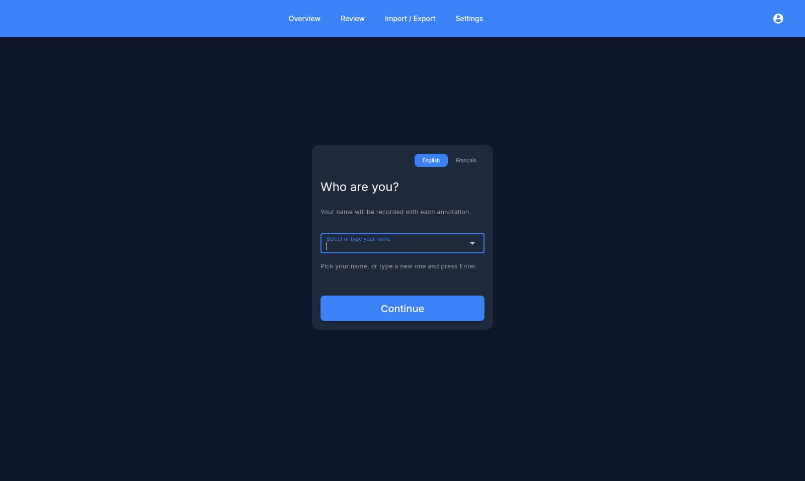
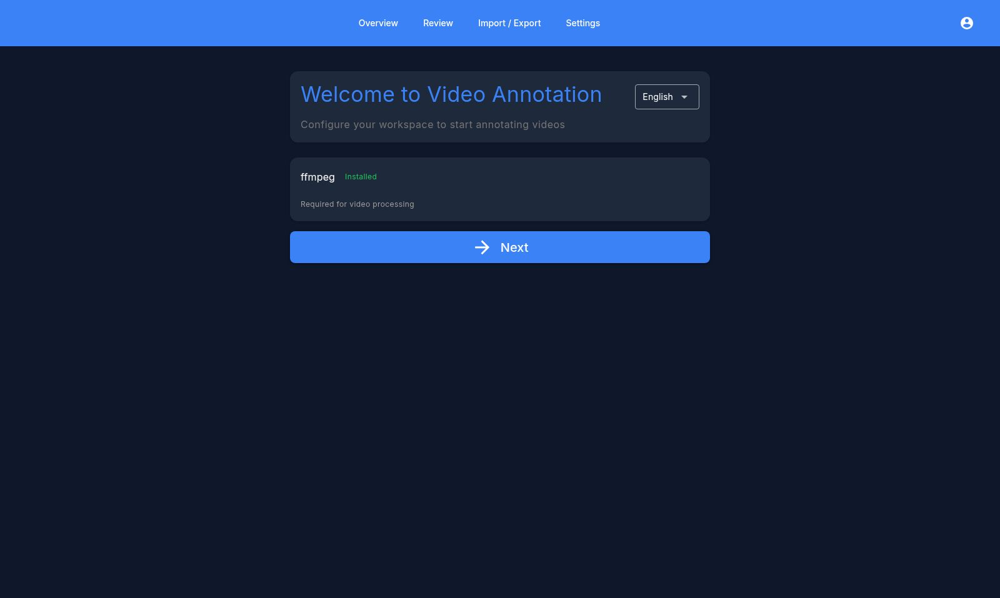
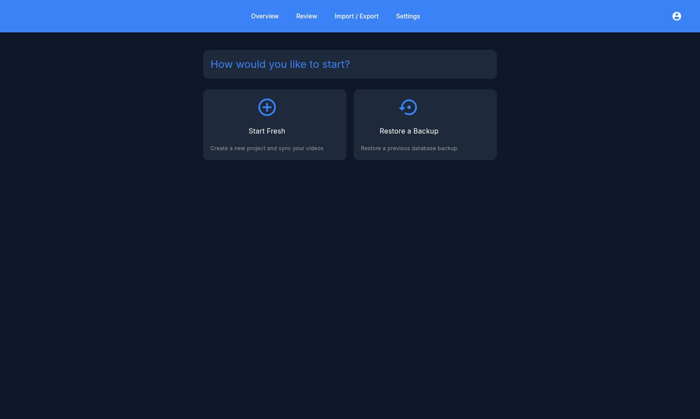
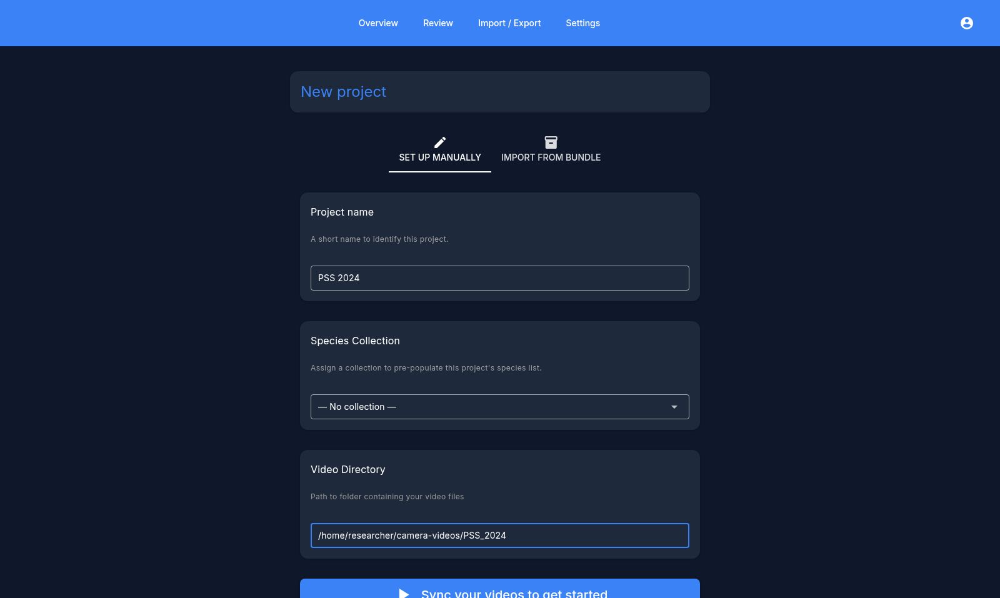
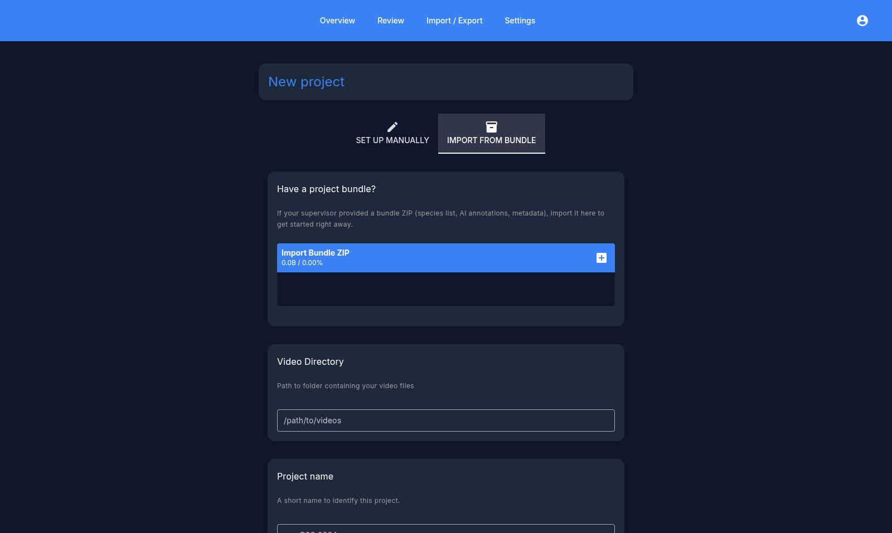
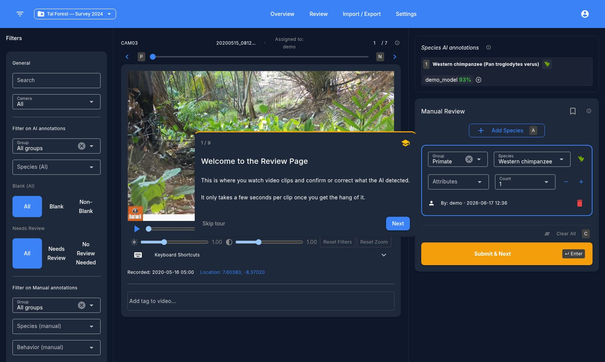

# Premiers pas

Cette page décrit tout le parcours, de l'installation de l'application à la revue de votre première vidéo.

## Installation

L'application est distribuée sous forme d'exécutable autonome pour Linux, Windows et macOS — aucune installation de Python n'est nécessaire. Téléchargez la version correspondant à votre système depuis la page [Releases](https://github.com/wild-chimpanzee-foundation/review-app/releases) du projet et lancez-la.

Il n'y a rien à installer en dehors de l'exécutable lui-même : la base de données, vos paramètres et les sauvegardes automatiques sont tous stockés dans un dossier utilisateur géré par l'application.

### ffmpeg

L'application a besoin de **ffmpeg** pour la lecture vidéo, les vignettes et la lecture des métadonnées vidéo. C'est un outil gratuit, à installer une seule fois, qui n'est pas fourni avec l'application : vous devez donc l'ajouter une fois. L'assistant de configuration le vérifie et affiche **Installé** lorsqu'il est prêt.

#### Windows

1. **Ouvrez un terminal (PowerShell).** Cliquez sur le menu **Démarrer**, tapez `powershell`, et cliquez sur **Windows PowerShell**. (Ou appuyez sur **Win + R**, tapez `powershell`, et appuyez sur Entrée.)
2. **Installez ffmpeg** en exécutant :

    ```powershell
    winget install ffmpeg
    ```

3. **Fermez le terminal et ouvrez-en un nouveau**, puis vérifiez que ça a fonctionné :

    ```powershell
    ffmpeg -version
    ```

    Si une bannière de version s'affiche, c'est terminé.

#### macOS / Linux

- **macOS :** `brew install ffmpeg` (installez d'abord [Homebrew](https://brew.sh) si nécessaire)
- **Linux :** `sudo apt install ffmpeg` (ou le gestionnaire de paquets de votre distribution)

Si vous installez ffmpeg alors que l'assistant de configuration est déjà ouvert, **redémarrez l'application** pour qu'elle revérifie, puis poursuivez une fois que le statut indique **Installé**.

## Premier lancement

Lors d'une nouvelle installation, aucune base de données n'existe encore : l'application vous guide donc à travers une courte configuration unique avant d'atteindre l'interface principale.

### 1. Indiquez qui vous êtes

Le premier écran demande votre nom. Chaque annotation que vous réalisez est associée à ce nom, ce qui permet à une équipe de répartir le travail et de suivre qui a revu quoi.



Choisissez votre nom dans la liste s'il y figure déjà, ou saisissez-en un nouveau et appuyez sur **Entrée**. Vous pouvez aussi changer la langue de l'interface (English / Français) depuis le sélecteur en haut à droite — ce choix est mémorisé et modifiable ensuite dans les Paramètres. Cliquez sur **Continuer**.

!!! note
    Ce nom vous identifie en tant qu'*annotateur* ; ce n'est pas un compte protégé par mot de passe. Sur une machine partagée, chaque personne sélectionne simplement son propre nom. Vous pouvez changer de nom plus tard depuis le menu compte en haut à droite de l'en-tête.

### 2. Bienvenue & vérification du système

L'assistant de configuration s'ouvre ensuite. La première étape confirme votre langue et vérifie que ffmpeg est disponible.



Une fois que ffmpeg indique **Installé**, cliquez sur **Suivant**.

### 3. Nouveau départ ou restauration

L'assistant demande ensuite comment vous souhaitez commencer :



- **Nouveau départ** — créer une base de données toute neuve et configurer votre premier projet. Choisissez cette option lors de la première utilisation.
- **Restaurer une sauvegarde** — charger un fichier de sauvegarde `.db` exporté précédemment. Utilisez-la pour transférer votre travail vers un nouvel ordinateur, ou pour récupérer après une réinstallation. Les sauvegardes déjà présentes vous sont proposées, et vous pouvez aussi téléverser un fichier `.db`.

### 4. Créez votre premier projet

Choisir **Nouveau départ** vous amène à la création de projet. Un **projet** est un nom associé à un dossier de vidéos de pièges photographiques sur le disque (voir [plus bas](#quest-ce-quun-projet)). Il y a deux onglets :

**Configurer manuellement** — pointez l'application vers un dossier de vidéos :



1. **Nom du projet** — une étiquette courte, par ex. `PSS 2024`.
2. **Collection d'espèces** *(optionnel)* — pré-remplit la liste d'espèces du projet à partir d'une collection enregistrée. Laissez sur *Aucune collection* en cas de doute ; vous pourrez configurer les espèces plus tard.
3. **Répertoire vidéo** — le chemin complet vers le dossier contenant vos vidéos. L'application le parcourt récursivement.
4. **Inventaire des déploiements** — téléchargez le modèle CSV, remplissez-le et importez-le. Seul `deployment_id` est obligatoire. Colonnes facultatives : `folder_path`, `name`, `camera_id`, `installation_date`, `retrieval_date`, `transect_id`, `habitat` et `notes`. Utilisez UTF-8 et des virgules ou points-virgules comme séparateurs. Les dates suivent le format `AAAA-MM-JJ`. Vérifiez les correspondances proposées par dossier avant de créer le projet. L’aperçu indique les vidéos non résolues, les déploiements en concurrence, les déploiements sans vidéo et les avertissements concernant les colonnes ignorées ou les dossiers absents. Sinon, choisissez explicitement **Options avancées → Déduire l’inventaire des déploiements à partir des dossiers sans CSV**.
5. Cliquez sur **Synchronisez vos vidéos pour commencer**. L'application enregistre le projet et son inventaire ensemble, puis analyse le dossier, enregistre chaque vidéo trouvée et lit les métadonnées de base (durée, ainsi que l'horodatage/GPS si disponibles).

Ouvrez **Vue d’ensemble → Gérer les déploiements** pour réviser les dossiers, ajouter des déploiements, modifier leurs métadonnées et inspecter les vidéos. Le tableau principal affiche une ligne par dossier contenant directement des vidéos : effectifs, vidéos à résoudre, références sans vidéos ordinaires et exceptions individuelles. Désactivez **À vérifier uniquement** pour afficher tous les dossiers. Les changements sont prévisualisés puis confirmés ; les déplacements qui invalideraient un travail Distance enregistré, des références étalonnées ou des affectations figées sont bloqués, sans changement partiel.

Choisissez **Réviser les dossiers…** pour ouvrir le premier dossier correspondant aux filtres, ou sélectionnez une ligne pour commencer par ce dossier. Vérifiez les suggestions avec vos relevés de terrain. Les indices peuvent inclure un même transect ou une même caméra, des zéros initiaux ou un nom de dossier de référence abrégé. Vous pouvez rechercher un déploiement, en ajouter un ou modifier ses métadonnées dans le dialogue.

Pour associer tout le dossier, choisissez un déploiement sans sélectionner de vidéos. Cliquez sur **Prévisualiser les changements**, puis sur **Associer le dossier et continuer**. Pour un dossier de référence partagé, sélectionnez une vidéo pour la visionner. Sélectionnez ensuite les vidéos d’un même déploiement, choisissez celui-ci et cliquez sur **Prévisualiser les changements**, puis sur **Appliquer les associations des vidéos**. Répétez l’opération pour chaque groupe, puis cliquez sur **Dossier suivant**. **Précédent** permet de revenir au dossier précédent et les modifications confirmées sont conservées.

Chaque `folder_path` facultatif crée une association initiale de dossier. Cette association s’applique aux fichiers directement contenus dans le dossier, y compris ceux découverts plus tard, mais pas aux sous-dossiers. Les associations individuelles ont priorité et sont conservées lors des nouvelles analyses ; **Utiliser l’association du dossier** supprime cette exception. Les dossiers absents sont conservés avec un avertissement. En l’absence d’association, l’identifiant doit correspondre au nom du dossier ou à son début suivi d’un séparateur, sans distinction de casse et en normalisant espaces, tirets et traits de soulignement. Par exemple, `48_cam086` correspond à `48_Cam086_814419_1116757_20260221`, mais `cam45` ne correspond pas à `cam453`. Les correspondances automatiques sont recalculées lors de chaque analyse. Les correspondances ambiguës restent à résoudre. Les vidéos de dossiers racines distincts doivent être associées explicitement pour partager un déploiement. Les vidéos ordinaires et leurs références doivent partager un déploiement pour la révision Distance.

La saisie de positions/SCR n’est pas incluse. Aucun CSV n’est demandé pour les projets existants ou les paquets ouverts ; leurs associations historiques sont conservées. Les paquets v1 existants restent compatibles, mais l’export d’un même déploiement explicitement lié à plusieurs racines est refusé : ce format ne peut pas conserver cette identité commune.

**Ouvrir un paquet** — si un collègue a préparé une affectation ou un ancien bundle de configuration :



Chargez le ZIP de configuration, pas un ZIP de retour. **Contenu du paquet** résume
le vocabulaire, les prédictions, les annotations existantes et, pour Distance,
les tâches et références nécessaires. Confirmez le nom local de l’annotateur et
indiquez chaque dossier vidéo en conservant les sous-dossiers relatifs affichés.
Les paquets d’affectation créent des projets de travail liés et synchronisent
uniquement les vidéos répertoriées ; utilisez **Télécharger la progression** après
révision. L’association à un nom local ne change ni le destinataire du paquet ni
les attributions historiques.

Les anciens bundles créent toujours des projets indépendants : choisissez un
dossier vidéo et un nom de projet, puis confirmez les associations d’annotateurs.
Ces projets analysent normalement le dossier et ne proposent pas de retour
d’affectation. Utilisez les [affectations](settings.md#affectations) pour les
nouvelles délégations. **Ouvrir un paquet** reste disponible dans le sélecteur de
projet après la configuration initiale.

Une fois la synchronisation terminée, l'assistant propose d'aller directement à **Importer les résultats du modèle** ou d'ouvrir le **Tableau de bord**.

## Qu'est-ce qu'un projet

Un projet associe un **nom à un ou plusieurs dossiers vidéo**. Les projets ordinaires analysent ces dossiers récursivement ; les projets de travail d’affectation vérifient uniquement les vidéos répertoriées dans le paquet. Formats pris en charge : `mp4`, `avi`, `mov`, `mkv`, `webm`, `wmv`, `flv`, `m4v`.

Vous pouvez conserver plusieurs projets dans une même base de données et basculer entre eux depuis le menu déroulant à gauche de l'en-tête. Pour ajouter d'autres projets ensuite, utilisez le sélecteur de projet ou les **Paramètres**.

!!! note
    Les caméras n'ont pas besoin d'être configurées séparément — l'**identifiant de caméra de chaque vidéo est déduit automatiquement de la structure de vos dossiers** lors de la synchronisation. Organiser les séquences en `.../CAM01/clip.mp4`, `.../CAM02/clip.mp4` suffit pour que les statistiques par caméra et la répartition du travail fonctionnent.

Si vous ajoutez ou supprimez des fichiers sur le disque plus tard, relancez l'analyse depuis **Paramètres → Dossier vidéo → Synchroniser les vidéos** pour prendre en compte les changements.

## Configuration initiale

Une fois le projet créé, l'essentiel à configurer avant de commencer la revue est la **liste d'espèces** — seules les espèces activées apparaissent dans les contrôles d'annotation :

- Allez dans **Paramètres → Paramètres avancés → Espèces du projet** et activez les espèces pertinentes pour votre projet depuis le catalogue global, ou ajoutez des espèces personnalisées. (Si vous avez importé un bundle ou choisi une collection d'espèces, cette liste peut déjà être remplie.)

Vous pouvez aussi ajuster les **seuils de confiance** qui déterminent comment les prédictions de l'IA sont affichées — seuils pour vidéo vide, espèces et détection d'objets — dans **Paramètres → Paramètres avancés → Détection des vidéos vides**. Voir la page [Paramètres](settings.md) pour la référence complète.

## Votre première revue

La première fois que vous ouvrez l'écran **Espèces**, une courte visite guidée met en évidence le lecteur vidéo, la file d'attente, les filtres et les contrôles d'annotation.



Parcourez-la avec **Suivant**, ou cliquez sur **Passer le tour** pour la fermer — dans tous les cas, elle ne réapparaîtra pas. À partir de là, vous êtes prêt à annoter ; voir [Espèces](reviewing.md) pour le guide complet.

Suite : [Tableau de bord](dashboard.md)
