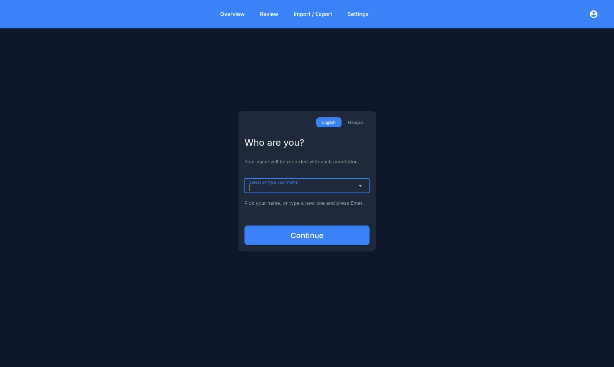
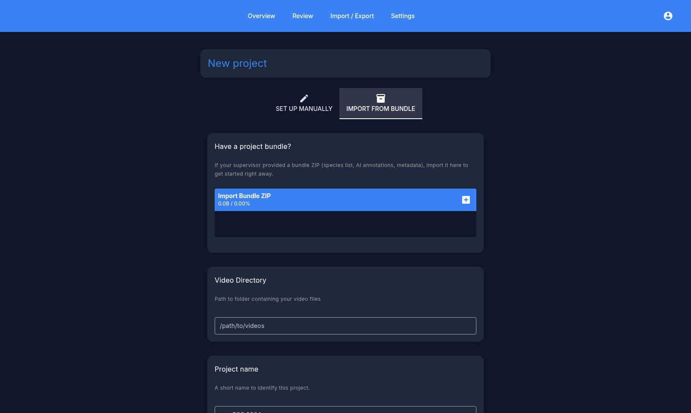

# Getting Started

This page walks through everything from installing the app to reviewing your first video.

## Installing

The app is distributed as a standalone executable for Linux, Windows, and macOS — no Python install required. Download the build for your platform from the project's [Releases page](https://github.com/wild-chimpanzee-foundation/review-app/releases) and run it.

There's nothing to install beyond the executable itself: the database, your settings, and automatic backups are all stored in a per-user data folder the app manages for you.

### ffmpeg

The app needs **ffmpeg** for video playback, thumbnails, and reading video metadata. It's a free, one-time install and isn't bundled with the app, so you'll need to add it once. The setup wizard checks for it and shows **Installed** when it's ready.

#### Windows

1. **Open a terminal (PowerShell).** Click the **Start** menu, type `powershell`, and click **Windows PowerShell**. (Or press **Win + R**, type `powershell`, and press Enter.)
2. **Install ffmpeg** by running:

    ```powershell
    winget install ffmpeg
    ```

3. **Close the terminal and open a new one**, then confirm it worked:

    ```powershell
    ffmpeg -version
    ```

    If you see a version banner, you're done.

#### macOS / Linux

- **macOS:** `brew install ffmpeg` (install [Homebrew](https://brew.sh) first if needed)
- **Linux:** `sudo apt install ffmpeg` (or your distribution's package manager)

If you install ffmpeg while the setup wizard is already open, **restart the app** so it re-checks, then continue once the status reads **Installed**.

## First run

On a fresh install there's no database yet, so the app guides you through a short one-time setup before you reach the main interface.

### 1. Tell the app who you are

The first screen asks for your name. Every annotation you make is tagged with this name, which is what lets a team split work and track who reviewed what.



Pick your name from the dropdown if it's already there, or type a new one and press **Enter**. You can also switch the interface language (English / Français) from the toggle in the top-right — this choice is remembered and can be changed later in Settings. Click **Continue**.

!!! note
    This name identifies you as an *annotator*; it isn't a password-protected account. On a shared machine, each person simply selects their own name. You can switch names later from the account menu in the top-right of the header.

### 2. Welcome & system check

Next, the setup wizard opens. The first step confirms your language and checks that ffmpeg is available.


Once ffmpeg shows **Installed**, click **Next**.

### 3. Fresh start or restore

The wizard then asks how you'd like to begin:


- **Start Fresh** — create a brand-new database and set up your first project. Choose this the first time you use the app.
- **Restore a Backup** — load a previously exported `.db` backup file. Use this to move your work to a new computer, or to recover after reinstalling. You'll be shown any backups the app already has, and can also upload a `.db` file.

### 4. Create your first project

Choosing **Start Fresh** brings you to project creation. A **project** is a name paired with a folder of camera-trap videos on disk (more on projects [below](#what-a-project-is)). There are two tabs:

**Set up manually** — point the app at a folder of videos:


1. **Project name** — a short label, e.g. `PSS 2024`.
2. **Species Collection** *(optional)* — pre-populate the project's species list from a saved collection. Leave as *No collection* if you're unsure; you can set up species later.
3. **Video Directory** — the full path to the folder containing your videos. The app scans it recursively.
4. **Deployment inventory** — download the CSV template, populate it, and upload it. Only `deployment_id` is required. Optional columns are `folder_path`, `name`, `camera_id`, `installation_date`, `retrieval_date`, `transect_id`, `habitat`, and `notes`. Use UTF-8 and comma or semicolon separators. Dates use `YYYY-MM-DD`. Review the proposed footage matches by folder before creating the project. The preview lists unresolved clips, competing deployment IDs, empty deployments, and warnings about ignored columns or missing directories. Alternatively, explicitly choose **Advanced options → Infer deployment inventory from folders instead of CSV**.
5. Click **Sync your videos to get started**. The app saves the project and inventory together, then scans the folder, registers every video it finds, and reads basic metadata (duration, and timestamp/GPS where available).

Open **Overview → Manage deployments** to review folders, add deployments, edit metadata, and inspect footage. The main table has one row per directly media-containing folder, with footage counts, unresolved videos, references without ordinary footage, and individual exceptions. Disable **Needs attention only** to see all folders. Assignment changes have a preview and confirmation step; moves that would invalidate saved Distance work, calibrated references or frozen assignments are blocked without partial changes.

Choose **Review folders…** to open the first matching folder, or select a row to start there. Check the suggested deployment against your field records. Common hints include matching transect or camera numbers, leading zeros, and shortened reference folder names. You can search the inventory, add a deployment, or edit metadata from the dialog.

For a whole-folder correction, choose a deployment with no clips selected. Click **Preview changes**, then **Apply folder link & next**. For a shared reference folder, select a clip to inspect it. Select the clips that belong together, choose a deployment, and click **Preview changes**, then **Apply clip assignments**. Repeat for each group, then click **Next folder**. **Back** revisits the previous folder and confirmed changes are retained.

Each optional `folder_path` becomes an initial folder link. A link applies to files directly in that folder, including files discovered later, but not to subfolders. Individual video assignments take precedence and survive rescans; **Use folder assignment** removes the individual exception. Missing folders are retained with a warning. Without a link, deployment IDs match folder names exactly or as a prefix followed by a separator, ignoring case and normalizing spaces, dashes and underscores. For example, `48_cam086` matches `48_Cam086_814419_1116757_20260221`, but `cam45` does not match `cam453`. Automatic matches are recalculated on rescan. Competing matches stay unresolved until you assign them. Footage in separate roots requires an explicit assignment to share a deployment. Ordinary footage and its reference clips must share a deployment for Distance review.

Location/CRS input is not included. Existing projects and opened packages do not require a deployment CSV; their historical assignments are retained. Existing v1 assignment packages remain supported, but exporting one deployment explicitly linked across multiple import roots is rejected because that format cannot preserve the shared identity.

**Open package** — if a colleague prepared an assignment or legacy setup bundle for you:



Upload the setup `.zip`, not a return ZIP. **Included in this package** summarizes
its vocabulary, predictions, existing annotations and, for Distance assignments,
task/reference dependencies. Confirm the local annotator name and locate each
footage root, preserving the displayed relative subfolders. Assignment packages
create linked working projects and sync only listed footage; use **Download return
progress** after reviewing. The packaged recipient and historical attribution
stay unchanged when you map the recipient to your local name.

Older setup bundles still open as independent projects: choose a video directory
and project name, then confirm any annotator-name mapping. These projects scan
the directory normally and do not have assignment returns. Use prepared
[assignments](settings.md#assignments) for new delegated work. **Open package** is
also available in the project picker after initial setup.

After the sync finishes, the wizard offers to jump straight to **Importing model results** or to open the **Dashboard**.

## What a project is

A project has a **name + one or more video folders**. Ordinary projects scan those folders recursively and register the videos they find; assignment working projects check only their packaged footage list. Supported formats: `mp4`, `avi`, `mov`, `mkv`, `webm`, `wmv`, `flv`, `m4v`.

You can keep multiple projects in one database and switch between them from the dropdown at the left of the header. To add more projects later, use the project switcher or **Settings**.

!!! note
    Cameras don't need to be configured separately — each video's **camera ID is inferred automatically from your folder structure** during the sync. Organising footage as `.../CAM01/clip.mp4`, `.../CAM02/clip.mp4` is enough for the per-camera stats and work distribution to work.

If you add or remove files on disk later, re-run the scan from **Settings → Video directory → Sync videos** to pick up the changes.

## Initial setup

Once a project exists, the main thing to configure before reviewing is the **species list** — only enabled species appear in the annotation controls:

- Go to **Settings → Advanced Settings → Project species** and enable the species relevant to your project from the global catalog, or add custom ones. (If you imported a bundle or chose a species collection, this may already be populated.)

You may also want to tune the **confidence thresholds** that decide how AI predictions are displayed — blank-detection, species, and object-detection thresholds — under **Settings → Advanced Settings → Blank detection**. See the [Settings](settings.md) page for the full reference.

## Your first review

The first time you open the **Species** screen, a short guided tour points out the video player, the queue, the filters, and the annotation controls.


Step through it with **Next**, or click **Skip tour** to dismiss it — either way it won't show again. From here you're ready to start annotating; see [Species](reviewing.md) for the full walkthrough.

Next: [Dashboard](dashboard.md)
