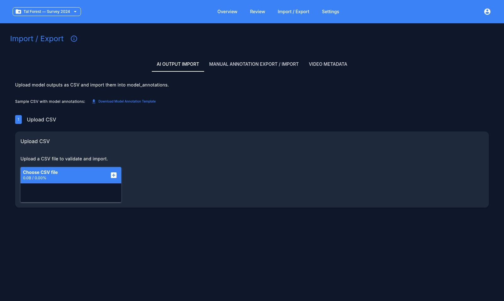

# Importer les résultats du modèle

Ouvrez **Importation / Exportation → Ajouter des données**. Choisissez **Prédictions IA**, **Métadonnées vidéo** ou **Annotations existantes**. Les retours sont dans **Affectations** ; l'ouverture d'un paquet reste dans le sélecteur de projet. Le vocabulaire reste dans les Paramètres.



## Annotations du modèle IA

Deux formats de CSV sont acceptés :

- **Format long** — une ligne par détection, avec les colonnes `video_path` (ou `filepath` / `review_filename` / `original_filepath` / `path`), `annotation_type` (`species`, `blank_non_blank`, `behavior` ou `object_detection`), `model_name`, `value_text`, `value_num`, `probability`, `t_start_sec`, `t_end_sec`.
- **Format large** — une ligne par vidéo, avec des colonnes telles que `top_1_<model>` pour l'espèce prédite, `prob_<model>`, `count_<model>`, et des colonnes de probabilité de vidéo vide. L'application détecte ce format automatiquement et propose une interface de mappage des colonnes.

Un modèle de CSV téléchargeable est disponible sur la page d'import si vous n'êtes pas sûr des colonnes attendues.

### Étapes d'import

1. **Téléversement** de votre CSV. L'application suggère automatiquement un mappage des chemins/colonnes.
2. **Aperçu de correspondance** — indique combien de chemins vidéo correspondent à des vidéos déjà présentes dans le projet, avec un échantillon des chemins non trouvés.
3. **Validation** — vérifie le fichier et indique le nombre de lignes valides/invalides, avec un échantillon de lignes valides.
4. **Revue et mappage des espèces** — toute espèce du CSV absente de la liste d'espèces du projet apparaît comme non mappée. Pour chacune, vous pouvez la mapper vers une espèce existante, l'ajouter comme nouvelle espèce, ou l'ignorer.
5. **Import** — seule cette dernière étape écrit dans la base de données. Les étapes d'aperçu et de validation ne modifient jamais votre projet.

!!! note
    Les lignes correspondant à des espèces laissées non mappées sont **ignorées** lors de l'import, afin que les données importées correspondent exactement à ce qui était affiché dans l'aperçu.

## Paquets Distance IA

Les brouillons Distance appartiennent à des tâches par espèce. Utilisez les
annotations Espèces existantes ou acceptez explicitement les espèces manquantes
du paquet dans l’aperçu. Il n’est pas nécessaire de marquer la revue ordinaire comme terminée.

Utilisez **Importation / Exportation → Ajouter des données → Prédictions IA → Distance IA** pour charger un ZIP `distance-ai` version 1 (32 Mio maximum). Créez/réanalysez d’abord le projet pour enregistrer ses vidéos, puis marquez les clips de référence comme **Vidéo de référence**. La structure appariée `<déploiement>/videos/` et `<déploiement>/references/` applique automatiquement cette étiquette.

La synchronisation marque aussi les vidéos sous les dossiers dont le nom commence ou se termine par un marqueur séparé `VR`, `V_R`, `ref`, `reference` ou `references`, par exemple `camera_VR`, `VR-camera`, `camera_ref` ou `reference-camera`, y compris les copies imbriquées. Pour la correspondance des déploiements uniquement, les noms sont convertis en minuscules et les suites d’espaces, de tirets et de traits de soulignement deviennent un seul `_` ; les chemins et noms de caméra réels restent inchangés. Le reste du nom doit correspondre exactement à un seul dossier ordinaire voisin, ou à un dossier de déploiement englobant pour les références imbriquées. Un dossier autonome `VR`/`V_R` apparié avec `Video`/`videos` utilise leur déploiement englobant. Les dossiers de référence sans correspondance ou ambigus sont marqués mais conservent un identifiant de caméra distinct : aucune déduction sur les dates ou numéros de caméra n’est faite. Relancez la synchronisation des projets existants pour appliquer ces règles.

1. Chargez le ZIP pour valider et prévisualiser les nombres d’enregistrements, les correspondances vidéo, les conflits d’étalonnage et jusqu’à 20 prédictions. L’aperçu n’écrit rien. Si des étiquettes Espèces manquent, **Accepter les annotations d’espèces manquantes** les ajoute comme annotations acceptées avec attribution IA, sans révision supplémentaire ni nouveau chargement. Les annotations et effectifs existants sont conservés ; les nouvelles annotations indiquent une présence avec un effectif inconnu, sans assimiler les pistes IA à un nombre d’animaux.
2. Tous les individus importés sont des brouillons IA couvrant la vidéo entière. L’intervalle dominant et la phase sont déduits des prédictions pour compléter les arrêts manquants, du début à la fin. Les temps fournis restent exacts ; le léger décalage dû aux images n’ajoute pas d’arrêts voisins. Une prédiction manquante pour un individu recommande **Absent**, toujours en attente de confirmation humaine. Sans au moins deux prédictions sur une même piste de la vidéo, l’intervalle ne peut pas être déduit. Seuls les brouillons IA intacts peuvent être remplacés, après confirmation.
3. Cliquez sur **Importer le paquet Distance IA**. La création des individus et échantillons en attente, le remplacement des brouillons intacts et l’import des références et de la provenance sont atomiques : une erreur laisse le projet inchangé.
4. Les images de référence préparées deviennent disponibles dans Distance. **Voir les prédictions importées** affiche une exécution enregistrée (100 lignes maximum).

### Contenu du paquet

Les trois CSV et `manifest.json` doivent être à la racine du ZIP. Un CSV sans enregistrements peut contenir uniquement son en-tête.

```json
{
  "format": "distance-ai",
  "version": 1,
  "source_id": "my-pipeline",
  "run_id": "run-001",
  "model": {"name": "my-distance-model", "version": null},
  "timing_basis": "video_playback_seconds"
}
```

Utilisez `null` si la version du modèle est inconnue. Les identifiants source/exécution sont conservés dans la provenance. Le contenu du paquet identifie l’import : réimporter un paquet identique ne change rien, même après des corrections humaines, des suppressions ou un import plus récent. Les différences de compression ZIP ou de documentation ne comptent pas. Un contenu modifié constitue un nouvel import et suit les règles de remplacement ci-dessus, même avec le même `run_id`. Consulter un ancien paquet ne change ni les brouillons ni leur calendrier.

| Fichier | Colonnes |
|---|---|
| `reference_frames.csv` | `reference_id`, `video_path`, `time_s`, `known_distance_m`, `mask_path` facultatif |
| `individuals.csv` | `individual_id`, `video_path`, `species` |
| `predictions.csv` | `prediction_id`, `individual_id`, `time_s`, `predicted_distance_m`, `suggested_reference_id` facultatif, `mask_path` facultatif |

- Les identifiants sont des chaînes stables, uniques dans leur CSV. Les identifiants d’individu et de référence des prédictions renvoient aux autres CSV.
- `video_path` est un chemin exact relatif à la racine du projet, sans correspondance approximative ou par seul nom de fichier. Les chemins ambigus entre plusieurs racines doivent être résolus. Une référence suggérée doit appartenir au même déploiement que l’animal.
- `time_s` est un temps de lecture précis depuis le début de la vidéo, **pas une heure de la caméra**. Les distances doivent être finies et positives. `species` est un nom scientifique déjà présent dans le vocabulaire ; ajoutez ou mappez les espèces inconnues avant l’import.
- `known_distance_m` est la distance d’étalonnage ; `predicted_distance_m` est l’estimation pour l’animal. Elles peuvent différer. Une image préparée à la même milliseconde est réutilisée uniquement si sa distance et sa position précise correspondent ; un conflit bloque l’import sauf confirmation explicite de **Remplacer les images de référence en conflit et supprimer les mesures concernées**. L’aperçu compare les positions et indique le nombre de mesures concernées. Le remplacement modifie l’image et le masque, supprime les mesures utilisant cette référence (y compris les comportements et liens de portage) et rouvre les révisions concernées. Les autres références et individus sont conservés. Cette opération irréversible est atomique avec l’import Distance.
- Les champs facultatifs peuvent être absents ou vides. Chaque chemin de masque est relatif au ZIP et désigne un objet JSON COCO RLE : `size: [hauteur, largeur]` aux dimensions de l’image d’origine, et `counts` sous forme de liste d’entiers ou de chaîne compressée, dans l’ordre par colonnes. Les vidéos ne sont pas incluses.

!!! warning "Les prédictions ne sont pas des annotations validées"
    Les individus importés sont des individus Distance ordinaires ; leurs prédictions sont des échantillons **en attente**, pas des réponses humaines. Les suggestions sont préremplies pour confirmation ou correction. Les valeurs IA d’origine (temps, estimation, référence suggérée et masque) restent conservées après confirmation. Les cadres d’identification proviennent du premier masque exploitable ; sans masque, aucun cadre n’est inventé. Les absences déduites sont des recommandations IA, pas des absences confirmées ni un achèvement humain. Les échantillons en attente ne comptent pas dans la progression ou les distances validées du graphique. La date/heure absolue reste inconnue. Activez « Afficher les masques animaux IA » pour les superposer sur leurs images de prédiction exactes ; ils sont masqués pendant la lecture, la recherche et le dessin des cadres. Seuls les brouillons IA intacts peuvent être remplacés ; le travail humain est conservé sauf suppression explicitement confirmée des mesures utilisant une référence remplacée.

## Annotations historiques / manuelles

Pour réimporter des feuilles de calcul d'annotations exportées précédemment ou provenant d'une source externe. Prend en charge soit des colonnes de chemin séparées (dossier + nom de fichier), soit une colonne de chemin unique, avec des sélecteurs de colonnes pour l'espèce, le comportement, le nombre, l'observateur et l'horodatage. Vous choisissez si l'import doit **remplacer** les annotations existantes ou s'**ajouter** à elles. La même étape de mappage des espèces s'applique, avec en plus une option pour mapper directement vers « vide ».

## Annotations au format de l'application

Les exportations de l'application incluent un `observation_uuid` stable. En mode ajout, une observation dont l'UUID existe déjà dans la base de données est mise à jour plutôt qu'insérée à nouveau. Les anciens fichiers CSV sans cette colonne restent pris en charge, mais leur importation répétée en mode ajout peut créer des doublons.

La correspondance des UUID est limitée à la vidéo de destination, ce qui permet aussi de copier les annotations dans un autre projet. Un UUID fourni est prioritaire sur l'identifiant numérique `observation_id`. Les lignes identiques partageant un UUID pour une même vidéo sont importées une seule fois ; les doublons contradictoires et les UUID mal formés sont rejetés avec les numéros des lignes CSV (en comptant l'en-tête). Importer une ancienne exportation peut écraser des modifications plus récentes des observations correspondantes.

Si votre CSV est au format d'export propre à l'application (détecté via les colonnes `video_path`/`video_id` + `is_blank`), l'application affiche un résumé à blanc des vidéos trouvées/ignorées et des observations à insérer/mettre à jour/supprimer avant que vous ne confirmiez l'import.

## Retours d’affectation, CSV par lot et anciens bundles

Ces opérations sont distinctes :

- **ZIP de retour d’affectation** : utilisez **Importation / Exportation → Affectations → Accepter le travail retourné** dans le projet d’origine. Examinez l’aperçu avant d’accepter. Pour Espèces uniquement, **Ajouter** ajoute les nouvelles observations, met à jour les UUID correspondants, conserve les observations absentes du retour, fusionne les étiquettes et préserve les états vidéo locaux en cas de conflit. Une observation plus récente ayant le même UUID peut néanmoins être écrasée ; ce n’est pas une résolution automatique des conflits. Distance utilise **Conserver l’existant** ou **Utiliser l’import**, par tâche entière.
- **CSV historiques par lot** : utilisez **Ajouter des données → Annotations existantes → Import par lot**. Plusieurs CSV sont importés dès l’envoi en mode ajout, sans aperçu d’affectation. L’import CSV Espèces ordinaire permet la validation et le choix entre ajout et remplacement.
- **ZIP de configuration reçu** : choisissez **Ouvrir un paquet** dans le sélecteur de projet. Le résumé **Contenu du paquet** explique les données incluses. Les nouveaux paquets d’affectation créent des projets de travail liés ; les anciens bundles contenant `species.csv`, `tags.csv`, `model_annotations.csv` et `metadata.csv` créent des projets indépendants sans retour d’affectation. Leur ouverture reste prise en charge, mais utilisez les affectations préparées pour les nouvelles délégations.

Suite : [Espèces](reviewing.md)
