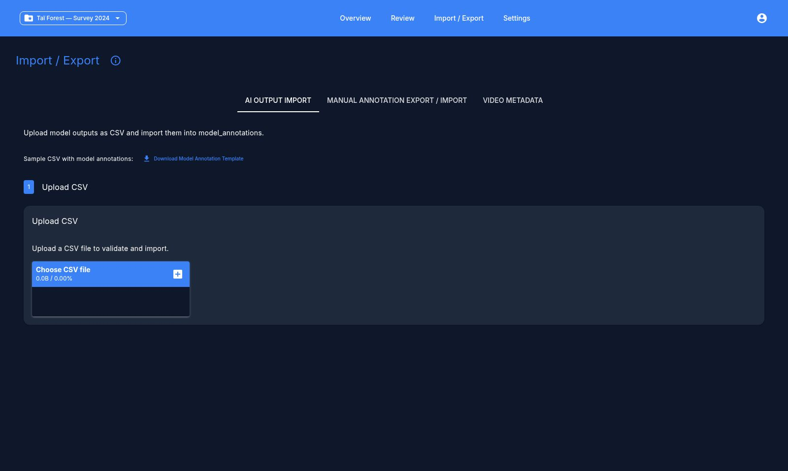

# Importing Model Results

Imports happen on the **Model Import** page, which has separate tabs for model annotations, AI Distance packages, historic/manual annotations, and metadata. Project bundles have a separate import flow.



## AI model annotations

Two CSV shapes are accepted:

- **Long format** — one row per detection, with columns `video_path` (or `filepath` / `review_filename` / `original_filepath` / `path`), `annotation_type` (`species`, `blank_non_blank`, `behavior`, or `object_detection`), `model_name`, `value_text`, `value_num`, `probability`, `t_start_sec`, `t_end_sec`.
- **Wide format** — one row per video, with columns like `top_1_<model>` for the predicted species, `prob_<model>`, `count_<model>`, and blank-probability columns. The app detects this shape automatically and offers a column-mapping UI.

A downloadable CSV template is available on the import page if you're unsure of the expected columns.

### Import steps

1. **Upload** your CSV. The app suggests a path/column mapping automatically.
2. **Match preview** — shows how many video paths matched videos already in the project, with a sample of any unmatched paths.
3. **Validate** — checks the file and reports valid vs. invalid row counts, with a sample of valid rows.
4. **Review & map species** — any species name in the CSV that isn't in your project's species list shows up as unmapped. For each one you can map it to an existing species, add it as a new species, or ignore it.
5. **Import** — only this final step writes to the database. Validation and preview steps never modify your project.

!!! note
    Rows for species left unmapped are **skipped** on import, so the imported data matches exactly what you saw in the preview.

## AI Distance packages

Use **Model Import → AI Distance** to upload a `distance-ai` version 1 ZIP (maximum 32 MiB). First create/rescan the destination project so its videos are registered, and tag reference clips as **Reference Video**. The paired `<deployment>/videos/` and `<deployment>/references/` layout applies this tag automatically.

1. Upload the ZIP to validate it and preview counts, video matches, calibration conflicts, and up to 20 predictions. Preview does not write anything.
2. Imported individuals are complete AI drafts covering the full video. The dominant within-track interval and fractional-time phase are inferred to fill missing stops from the opening frame through the end (excluding the endpoint). Supplied timestamps stay exact; nearby frame-timing jitter does not add duplicate stops. Missing predictions for an individual recommend **Absent**, still pending human confirmation. At least two predictions on one track in the video are needed to infer cadence. Only untouched AI drafts can be replaced, with confirmation.
3. Click **Import AI Distance package**. Creating individuals and pending samples, replacing untouched drafts, and importing references and provenance are atomic: an error leaves the project unchanged.
4. Prepared reference frames become available in Distance's reference browser. Use **View imported predictions** to inspect a saved run (up to 100 rows).

### Package contents

All three CSVs and `manifest.json` must be at the ZIP root. CSVs may contain only a header when there are no records of that type.

```json
{
  "format": "distance-ai",
  "version": 1,
  "source_id": "my-pipeline",
  "run_id": "run-001",
  "model": {"name": "my-distance-model", "version": null},
  "timing_basis": "video_playback_seconds"
}
```

Use `null` for an unknown model version. Source/run IDs are retained as provenance. Package content identifies an import: identical reimports are always no-ops, even after human corrections, deletions, or a later import. ZIP compression and documentation differences do not count. Changed content is a new import subject to the replacement rules above, even with the same `run_id`. Viewing an older package does not switch drafts or schedules.

| File | Columns |
|---|---|
| `reference_frames.csv` | `reference_id`, `video_path`, `time_s`, `known_distance_m`, optional `mask_path` |
| `individuals.csv` | `individual_id`, `video_path`, `species` |
| `predictions.csv` | `prediction_id`, `individual_id`, `time_s`, `predicted_distance_m`, optional `suggested_reference_id`, optional `mask_path` |

- IDs are stable strings, unique within their respective CSV. Prediction individual/reference IDs link to the other CSVs.
- `video_path` is an exact project-root-relative path, not a filename-only or fuzzy match. Ambiguous paths across multiple project roots must be resolved before import. Suggested references must belong to the animal video's deployment.
- `time_s` is precise, zero-based playback time within the video, **not camera wall time**. Distances must be finite and positive. `species` must be a scientific name already in the vocabulary; add or map unknown species before importing.
- `known_distance_m` is reference calibration; `predicted_distance_m` is the animal estimate. They may differ. Existing calibration at the same millisecond frame is reused only when distance and precise position agree; conflicting calibration is never overwritten.
- Optional fields may be omitted or empty. Each mask path is ZIP-relative and points to one COCO RLE JSON object: `size: [height, width]` in original-frame dimensions, and `counts` as an integer list or compressed string in column-major order. Videos are not included.

!!! warning "Predictions are not reviewed annotations"
    Imported individuals are ordinary Distance individuals; their predictions are **pending samples**, not human answers. Suggestions prefill choices for confirmation or correction. Original AI values (time, estimate, suggested reference and mask) remain preserved after confirmation. Identifying boxes use the first usable mask; without one, no box is invented. Inferred absences are AI recommendations, not confirmed absence or human completion. Pending samples do not count toward progress or reviewed graph distances. Absolute camera date/time stays unknown. Use **Show AI animal masks** to overlay them on their exact prediction frames; they hide during playback, seeking, and box drawing. Only untouched AI drafts can be replaced; import never resets human work.

## Historic / manual annotations

For re-importing previously exported or external annotation spreadsheets. Supports either split path columns (folder + filename) or a single combined path column, with column pickers for species, behavior, count, observer, and timestamp. You choose whether the import should **override** existing annotations or **append** to them. The same species-mapping step applies, plus an option to map directly to "blank."

## App-format annotations

App exports include a stable `observation_uuid`. In append mode, an observation with a UUID already present in the database is updated rather than inserted again. Older CSV files without this column remain supported, but repeated append imports of those legacy files can create duplicates.

UUID matching is scoped to the destination video, so annotations can also be copied into another project. When a UUID is supplied, it takes precedence over the numeric `observation_id`. Identical rows with the same UUID for one video are imported once; conflicting duplicates and malformed UUIDs are rejected with CSV row numbers (including the header). Importing an older export can overwrite newer edits to matching observations.

If your CSV is the app's own exported format (detected via `video_path`/`video_id` + `is_blank` columns), the app shows a dry-run summary of matched/skipped videos and observations to insert/update/delete before you confirm the import.

## Batch and bundle import

For distributing work across multiple annotators, you can import several files at once, or a single `.zip` bundle containing `species.csv`, `tags.csv`, `model_annotations.csv`, and `metadata.csv`.

Next: [Species](reviewing.md)
