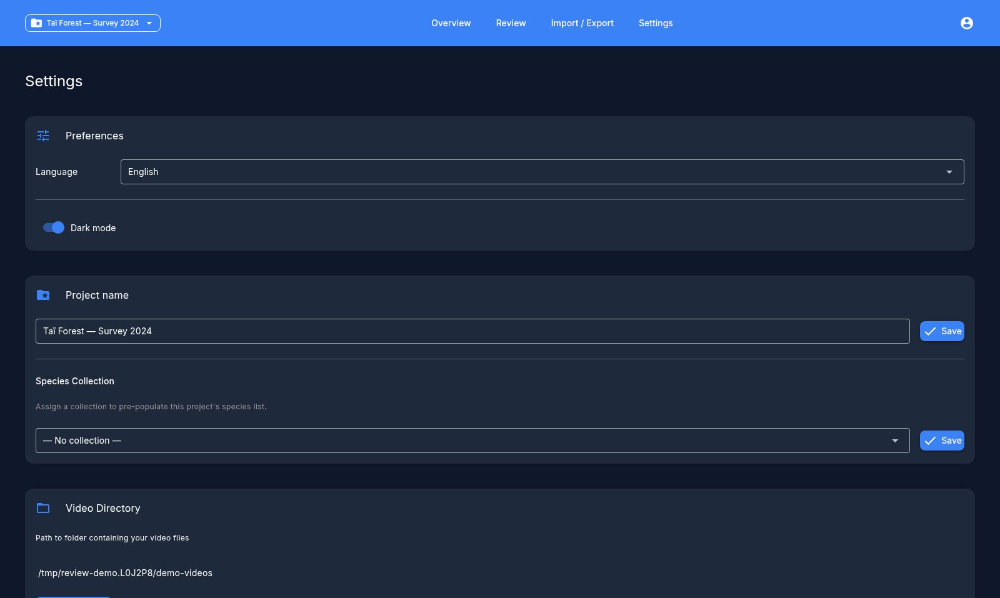

# Settings

The **Settings** page collects everything that configures the app and the active project. The most-used controls are at the top; less-frequent and destructive operations live under **Advanced Settings**.

## Preferences

- **Language** — switch the interface between English and French (reloads the app).
- **Dark mode** — toggle the light/dark theme.

## Project

Shown when a project is active:

- **Project name** — rename the active project.
- **Collection** — group the project under a named collection, or leave it uncategorized.

## Video directory

Shows the folder on disk that the active project scans for videos.

- **Sync videos** — re-scan the folder. New videos are registered; videos no longer on disk are flagged. A progress dialog reports how many were scanned, added, and removed.
- **Delete missing videos** — if videos in the database no longer exist on disk, a count appears here with a button to remove those records (confirmation required).

## Advanced Settings

An expandable section grouping the deeper configuration:

### Project species

Enable the species relevant to your project from the global catalog, or add custom ones. Only enabled species appear in the annotation controls. This is the main thing to set up before reviewing — see [Getting started](getting-started.md).

### Tags

Manage the tags that can be applied to videos. Built-in tags (such as `fire`, `nice_shot`, `broken_metadata`) are always available; you can add custom tags here.

### Blank detection

Three confidence-threshold sliders (0.0–1.0) that control how AI predictions are displayed:

- **Blank threshold** — how confident the model must be to treat a video as blank.
- **Species threshold** — minimum probability for a species prediction to be shown.
- **Object-detection threshold** — minimum probability for an object detection to be shown.

Click **Save** to apply.

### Distribution

Work allocation and handoff now live in **Data & assignments → Assignments**, not Settings. Expand the allocation section to split a project's videos across annotators. Saved assignments appear first; expand **Prepare assignment** to delegate new work.

1. Add the annotator names to distribute to.
2. Assign cameras to annotators manually, or use **Auto-distribute** to spread cameras evenly.
3. **Apply** to write the assignments; **Reset** clears them.

A summary table shows each annotator's cameras, videos, and hours. In the same
**Assignments** tab, hand off Species or Distance work:

1. Expand **Prepare assignment**, then choose the **Assignment stage** and a registered recipient:
   - **Species**: choose their applied distribution or all project videos.
   - **Distance**: choose one confirmed **Distance target species**, then **Load
     eligible Distance videos**. All eligible videos start selected; remove any
     you do not want to delegate. This selection is independent of Species
     distribution, includes manual and AI-linked tasks, and can include missing
     footage. Reference footage and calibration are collected automatically.
     Optionally enter both camera-local start/end times (24-hour format). The
     start is included, the end excluded, and overnight windows are supported.
     Tasks with unknown times are excluded only when a window is set; their
     count is shown. Changing the species/time filters clears the selection;
     load it again before preparing.
   Click **Prepare assignment**. Preparation freezes the selected work and saved
   state; later edits do not change that package.
2. **Download saved assignment**. For footage delivery, expand **Copy saved
   assignment footage** and choose an output folder on the computer running the
   app, outside the project footage folders. Send the generated folder and ZIP
   together. Each media root has its own subfolder. For Distance, the copy panel
   shows assigned videos + reference videos = total footage files. Copy results
   count both; references are dependencies, not additional assigned work. Check missing/failed counts;
   retry in a different output folder rather than overwriting an earlier delivery.
3. The recipient uses **Open package** in the project picker to create a fresh
   project, uploads the ZIP, and locates each media-root subfolder. Footage is not
   embedded in the ZIP. On the same machine, the original footage can be reused.
   Opening automatically syncs and probes listed work and reference footage,
   without discovering unlisted files. If
   that sync fails, retry it in the same form without creating another project.
4. After annotating, the recipient uses **Download return progress** in **Assignments** (also linked from Overview).
   Returns include every assigned video's saved state for the delegated stage
   and, for Distance, its one target species—even untouched, unfinished, or empty
   work. Annotation can continue after a return. Both review stages remain
   editable locally; other stages/species do not enter that assignment return.
5. In the origin project, upload the return under **Preview and accept returned
   work**. Review the stage, target species, counts, and warnings before accepting.
   The default **Use imported** replaces complete differing Species video states
   or Distance task states, including deletions and admin corrections. Choose
   **Keep existing** to leave differing origin work untouched; later annotator
   updates to those units are not applied. Changing the file invalidates
   confirmation; changing policy refreshes the preview. Destination changes after
   preview require a new preview.

For Distance returns, changed Species context warns but does not prevent accepting
saved-scope tasks. Acceptance does not restore or modify Species labels. Existing
admin reference calibration is reused by reference video and distance; substitutions
show the video, distance, and returned/admin playback positions, and keep the
admin mask. Returned sample distances are preserved. New distances can share a
frame timestamp without replacing other calibration.

Legacy CSV batch import now lives under **Data & assignments → Add data → Existing annotations**. It remains separate and appends annotations immediately on upload without an assignment preview. Manual Distance restoration is in the same area;
its manual-only format does not support AI-linked tasks or assignment identity.
Use assignment packages for delegated Distance work. **Open package** also detects
legacy setup bundles and explains that they create independent projects without
assignment returns.

Assignments show up on the [Dashboard](dashboard.md#assignment-summary) and as an annotator filter on the Species screen.

### Users / annotators

Lists everyone who has logged in as an annotator, with their annotation counts. You can delete an annotator who has no annotations — annotators with existing annotations (and your own current name) can't be deleted.

### Database management

- **Backup** — download a `.db` snapshot of the whole database.
- **Restore** — replace the current database from a previous backup (a safety backup is taken first).
- **Delete model annotations** — remove all imported AI predictions while keeping your manual annotations.
- **Reset database** — wipe everything and start fresh (a backup is taken first). Destructive — confirmation required.

## Diagnostics

At the bottom of the page:

- **Download log** — save `app.log` to send when reporting a problem.
- **Check for updates** — compare your version against the latest release and, if newer, offer a download link (a backup is taken before updating).
